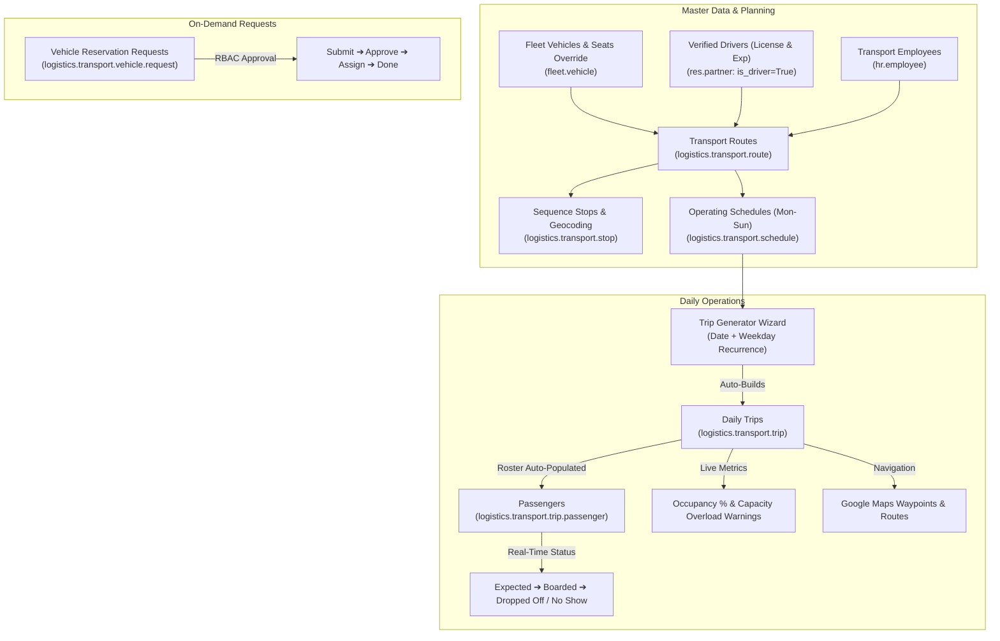

# 🚢 Freight & Staff Transport Management Suite (FMS)

[-714B67?style=flat&logo=odoo)](https://www.odoo.com)
[](https://www.gnu.org/licenses/lgpl-3.0.html)
[](https://www.python.org/)
[-success?style=flat&logo=checkmarx)](file:///home/nasim/programming/odoo19/env/freight_management_system/addons/Freight/)
[]()
[]()

A comprehensive, enterprise-ready **Logistics, Global Shipping, Freight Operations & Staff Transport Management System** built natively for **Odoo 19.0**. Designed to streamline global supply chains, multi-modal freight forwarding (Air, Ocean, Land), customs compliance, container lifecycles, and corporate workforce transit logistics with live routing and vehicle capacity planning.

---

## 📌 Table of Contents
- [Modules Overview](#-modules-overview)
- [Part 1: Freight Forwarding & Shipping (`trn_freight`)](#-part-1-freight-forwarding--shipping-trn_freight)
  - [Architecture & Workflow](#-freight-architecture--workflow)
  - [Operational Lifecycle Stages](#-freight-operational-lifecycle-stages)
  - [Customs Clearance & Document Revisions](#-customs-clearance--document-revisions)
  - [Transit Tracking, Invoicing & Protection Locks](#-transit-tracking-invoicing--protection-locks)
  - [Professional PDF Reports](#-professional-pdf-reports)
- [Part 2: Staff Transport Management (`trn_staff_transport`)](#-part-2-staff-transport-management-trn_staff_transport)
  - [Transport Architecture & Operational Flow](#-transport-architecture--operational-flow)
  - [Routes, Sequence Stops & Map Views](#-routes-sequence-stops--map-views)
  - [Operating Schedules & Weekday Recurrence](#-operating-schedules--weekday-recurrence)
  - [Daily Trips & Real-Time Passenger Lifecycle](#-daily-trips--real-time-passenger-lifecycle)
  - [Dedicated Driver Management (`res.partner`)](#-dedicated-driver-management-respartner)
  - [Fleet Vehicle & Employee Extensions](#-fleet-vehicle--employee-extensions)
  - [Automated Trip Generation Wizard](#-automated-trip-generation-wizard)
  - [On-Demand Vehicle Reservation Requests](#-on-demand-vehicle-reservation-requests)
- [Role-Based Access Control (RBAC)](#-role-based-access-control-rbac)
- [Multi-Company Isolation Architecture](#-multi-company-isolation-architecture)
- [Automated Test Suite & Quality Assurance](#-automated-test-suite--quality-assurance)
- [Repository & Module Structure](#-repository--module-structure)
- [Setup & Installation Guide](#-setup--installation-guide)
- [Author & Maintainer](#-author--maintainer)

---

## 📦 Modules Overview

This suite consists of two seamlessly integrated applications:

| Module | Technical Name | Category | Primary Purpose |
| :--- | :--- | :--- | :--- |
| **Freight Management** | `trn_freight` | Logistics / Freight | Multi-modal shipping orders, customs compliance, transit milestone tracking, automated customer invoicing, container lifecycle, and audit reports. |
| **Staff Transport** | `trn_staff_transport` | HR / Fleet Logistics | Corporate employee transport management: routes, geocoded stops, operating schedules, daily trips, passenger boarding, driver licensing, vehicle capacity management, and on-demand vehicle reservations. |

---

# 🚢 Part 1: Freight Forwarding & Shipping (`trn_freight`)

## 🏗️ Freight Architecture & Workflow

An end-to-end operational pipeline connecting order booking, customs compliance, transit tracking, automated customer invoicing, and backend lock enforcement:

```mermaid
flowchart LR
    A(["Draft Order"]):::start --> B["Add Cargo & Routes"]:::step
    B --> C["Port Compatibility Check"]:::step
    C --> D["Customs Clearance & BOL"]:::step
    D --> E{"Clearance<br/>Confirmed?"}:::gate

    E -- "Yes" --> F(["Order Confirmed"]):::milestone
    E -- "No" --> X["Confirmation Blocked"]:::blocked

    F --> G["Track Wizard & Chatter"]:::feature
    F --> H["Create Invoice (account.move)"]:::feature
    F --> L1["🔒 Lock 1: Cargo Protected"]:::lock

    H --> L2["🔒 Lock 2: Routes Protected"]:::lock
    H --> I(["Invoiced State"]):::milestone

    G --> J(["Order Done"]):::done
    I --> J
    J --> K["Containers Auto-Released"]:::step

    classDef start fill:#0f172a,stroke:#38bdf8,stroke-width:2px,color:#f8fafc;
    classDef step fill:#1e293b,stroke:#64748b,stroke-width:1.5px,color:#f8fafc;
    classDef gate fill:#1e293b,stroke:#f59e0b,stroke-width:2px,color:#fef3c7;
    classDef blocked fill:#450a0a,stroke:#ef4444,stroke-width:1.5px,color:#fca5a5;
    classDef milestone fill:#064e3b,stroke:#10b981,stroke-width:2px,color:#ecfdf5;
    classDef feature fill:#1e293b,stroke:#818cf8,stroke-width:1.5px,color:#e0e7ff;
    classDef lock fill:#3b1e08,stroke:#f97316,stroke-width:1.5px,color:#ffedd5;
    classDef done fill:#14532d,stroke:#22c55e,stroke-width:2px,color:#f0fdf4;
```



### 🔄 Freight Operational Lifecycle Stages

| Stage | Order State | Key Operations & Compliance Gate | System Automation & Protection Locks |
| :--- | :---: | :--- | :--- |
| **1. Order Booking** | `Draft` | Add cargo items, multi-leg routes, and services. | Port-transport compatibility validation. |
| **2. Customs Compliance** | `Draft` $\rightarrow$ `Submitted` | Generate `CLR/{FO}`, upload BOL & invoices, confirm clearance. | Gate: Order cannot confirm if clearance is in `Draft`. |
| **3. Confirmation** | `Confirmed` | Transition order, broadcast chatter notifications to partners. | 🔒 **Lock 1:** Cargo lines locked in ORM (`create/write/unlink`). Containers reserved. |
| **4. Tracking & Invoicing**| `Invoiced` | Log transit milestones via popup wizard; generate customer invoice. | 🔒 **Lock 2:** Route & service lines locked. **Invoice Total == Order Total**. |
| **5. Completion** | `Done` | Finalize shipment; post delivery notice to stakeholders. | Containers auto-released back to `available`. Order archived. |

---

## 🛃 Customs Clearance & Document Revisions

Bridges operational shipping orders with regulatory customs documentation and audit compliance:

| Component | Technical Model | Description |
| :--- | :--- | :--- |
| **Customs Clearance** | `custom.clearance` | Tracks customs declaration status (`draft`, `confirmed`, `done`), automatically inheriting ports, agent, and date from parent freight order. Name computed as `CLR/{order_name}`. |
| **Document Attachments** | `custom.clearance.line` | Stores regulatory files (`Binary`, `attachment=True`) such as Bills of Lading, Packing Lists, Certificates of Origin, and Commercial Invoices. |
| **Revision History** | `clearance.revision` | Immutable log of revisions tracking timestamp, author, mandatory reason, and notes (`REV/{clearance_name}/{seq}`). |
| **Revision Wizard** | `custom.clearance.revision` | Modal popup (`TransientModel`, `target='new'`) for drafting revisions with reason validation. |

### Business Rules Enforced:
1. **Confirmation Gate:** An order cannot transition to `confirmed` unless an attached customs clearance exists and is in `confirmed` or `done` state.
2. **Cascaded Draft Deletion:** Deleting a `draft` order automatically cleans up its associated `draft` clearance.
3. **Confirmed Clearance Lockdown:** An order with an active `confirmed` or `done` clearance cannot be deleted under any circumstances.
4. **Smart Navigation:** Dynamic stat buttons on Freight Orders show total clearances; stat buttons on Clearance forms show revision counters with instant one-click drill-down.

---

## 📍 Transit Tracking, Invoicing & Protection Locks

Connects operational freight orders to financial accounting, logs real-time transit milestones, broadcasts stakeholder notifications, and enforces backend integrity locks:

| Component | Technical Model | Description |
| :--- | :--- | :--- |
| **Tracking Model** | `freight.track` | Tracks transit legs on the order: `date`, `source_port_id`, `destination_port_id`, `transport`, and status (`Received` / `Delivered`). |
| **Tracking Wizard** | `freight.order.track` | Instant modal popup launched via the "Track" button on confirmed/invoiced orders; creates tracking records and posts chatter messages. |
| **Accounting Invoicing** | `account.move` (`out_invoice`) | Generates customer invoices for the shipper using `Command.create` with exactly 1 line per cargo line, route line, and service line. |
| **Integrity Locks** | Python ORM (`create`, `write`, `unlink`) | Strict ORM-level constraints blocking modification or removal of operational lines once orders advance. |

### Business Rules Enforced:
1. **Financial Exactness:** Customer Invoice Total **must exactly equal** Freight Order Total (`invoice.amount_total == order.total`) across weight-billed and volume-billed cargo, route pricing, and service fees.
2. **Cargo Line Lockdown:** Once an order reaches `confirmed` (or `invoiced`, `done`), cargo lines cannot be created, modified, or deleted (`UserError` raised on ORM level).
3. **Route & Service Line Lockdown:** Once an order reaches `invoiced` (or `done`), route stops and value-added service lines cannot be modified, added, or unlinked.
4. **Partner Notifications:** Dynamic notifications are broadcast to Shipper, Consignee, and Customs Agent upon `Submit`, `Confirm`, `Track`, and `Done` transitions.
5. **Smart Navigation:** A dedicated `Invoices` stat button on the Freight Order displays the invoice count and provides direct one-click navigation to the generated invoice.

---

## 📄 Professional PDF Reports

Natively built with QWeb and `wkhtmltopdf` for high-resolution, branded documentation:

| Report Action | Technical ID | Description |
| :--- | :--- | :--- |
| **Shipping Order Report** | `trn_freight.action_report_freight_shipping` | Comprehensive commercial document detailing shipper/consignee, carrier, multi-modal routing, itemized cargo specifications (weight, volume, pricing), service charges, and grand totals. |
| **Shipment Tracking Report** | `trn_freight.action_report_freight_tracking` | Audit-ready transit sheet showing leg-by-leg movement history, origin/destination ports, timestamps, transit status (`Received` / `Delivered`), and current delivery status. |

---

# 🚌 Part 2: Staff Transport Management (`trn_staff_transport`)

## 🏗️ Transport Architecture & Operational Flow

`trn_staff_transport` extends **HR** and **Fleet** modules into an end-to-end workforce logistics platform:



---

## 🛣️ Routes, Sequence Stops & Map Views

- **Transport Routes (`logistics.transport.route`):**
  - Manages fixed transport corridors with directionality (`pickup`, `drop_off`, `both`).
  - Auto-inherits vehicle capacity, calculates real-time occupancy rates, and tracks planned distance in kilometers.
  - Native **Google Maps action button** opening dynamic multi-waypoint turn-by-turn driving directions in the browser.
- **Ordered Route Stops (`logistics.transport.stop`):**
  - Sequence-ordered stops (`sequence`, `name`, `partner_id`, `stop_type`).
  - Integrated with **Odoo Map View (`web_map`)** using partner latitude and longitude coordinates.
  - Form & List view actions to open any stop directly on Google Maps.

---

## ⏰ Operating Schedules & Weekday Recurrence

- **Transport Schedules (`logistics.transport.schedule`):**
  - Departure and arrival timings stored in 24-hour decimal float format with `float_time` widgets.
  - **7-day weekly recurrence matrix** (`monday` through `sunday`).
  - Capable of overriding route vehicles and drivers on specific schedules.
  - Validates that arrival time occurs strictly after departure time and at least one operating day is selected.

---

## 🚍 Daily Trips & Real-Time Passenger Lifecycle

- **Daily Trip Management (`logistics.transport.trip`):**
  - Sequential reference auto-generated via `ir.sequence` (e.g. `TRP/2026/00198`).
  - Full lifecycle workflow: `Draft` $\rightarrow$ `Planned` $\rightarrow$ `In Progress` $\rightarrow$ `Completed` (or `Cancelled`).
  - Real-time departure and arrival timestamp logging (`actual_departure_datetime`, `actual_arrival_datetime`).
  - Dynamic **Occupancy Rate (%)** progress bar and **Over Capacity Warning Ribbon** (`is_over_capacity`) alerting dispatchers when passenger demand exceeds vehicle seating capacity.
- **Passenger Roster & Boarding Flow (`logistics.transport.trip.passenger`):**
  - Tracks every passenger assigned to the trip.
  - Individual boarding lifecycle: `Expected` $\rightarrow$ `Boarded` $\rightarrow$ `Dropped off` (or `No-show`).
  - Validates that passenger pickup/drop-off stops strictly belong to the trip's route and match direction requirements.
  - Prevents assigning the same employee more than once to a single trip.

---

## 🪪 Dedicated Driver Management (`res.partner`)

To prevent cluttering the transport dispatcher interface with unrelated contacts (companies, general users, or countries), a dedicated driver domain architecture has been implemented:

- **Driver Identification on `res.partner`:**
  - `is_driver` boolean flag (indexed and tracked).
  - `driver_license_number` (Driving license number).
  - `driver_license_type` (`Motorcycle`, `LTV`, `HTV`, `PSV`, `Commercial`, `Other`).
  - `driver_license_expiry` (Date validation).
  - `trip_count` compute with dynamic Trips smart button.
- **Strict Dropdown Filtering:**
  - In Trips, Routes, Schedules, Vehicle Requests, and Fleet Vehicles, the `driver_id` field enforces:
    ```python
    domain="[('is_driver', '=', True), '|', ('company_id', '=', False), ('company_id', '=', company_id)]"
    context="{'default_is_driver': True, 'default_is_company': False}"
    ```
  - Eliminates unrelated partners, system administrators, and countries from driver dropdowns.
- **Dedicated Dispatcher UI:**
  - Dedicated menu at **Staff Transport → Planning → Drivers** with Kanban, List, and Form views for managing drivers and inspecting assigned trips.

---

## 🚘 Fleet Vehicle & Employee Extensions

- **Fleet Vehicle Extension (`fleet.vehicle`):**
  - `seat_capacity_override`: Configures custom transport seating configurations differing from manufacturer default seats.
  - `effective_capacity`: Computed field used by routes and trips for capacity calculations.
  - Trips smart button displaying assigned transport routes.
  - Driver and future driver fields filtered to verified drivers (`is_driver = True`).
- **HR Employee Extension (`hr.employee`):**
  - `transport_enabled`: Enables/disables corporate transport benefit per employee.
  - Direct assignment to `transport_route_id`, `pickup_stop_id`, `dropoff_stop_id`, and `transport_direction`.
  - Constrained validation ensuring stops assigned to an employee strictly belong to the employee's assigned route.

---

## 🪄 Automated Trip Generation Wizard

- **Batch Generator (`logistics.transport.generate.trips.wizard`):**
  - Accessible via **Staff Transport → Operations → Trips → Generate Daily Trips** (or directly from Route form views).
  - Generates daily trips for any target date based on weekday schedule recurrence.
  - Filters by route direction (`All`, `Pickup`, `Drop-off`).
  - **Strict Idempotency:** Running the wizard multiple times for the same date skips already generated trips and prevents duplicates.
  - **Automated Roster Population:** Automatically reads employees assigned to each route and adds them as `Expected` passengers at their designated pickup/drop-off stops.

---

## 📋 On-Demand Vehicle Reservation Requests

- **Vehicle Requests (`logistics.transport.vehicle.request`):**
  - Employee ad-hoc vehicle reservation workflow: `Draft` $\rightarrow$ `Submitted` $\rightarrow$ `Approved` $\rightarrow$ `Assigned` $\rightarrow$ `Done` (or `Rejected`).
  - **Collision & Overlap Prevention:** SQL/Python level validation (`_check_vehicle_overlap`) preventing the same vehicle from being double-booked for overlapping time ranges.
  - **Self-Approval Blockage:** Users cannot approve their own vehicle requests; approval is restricted to transport managers.
  - **Delete Locks:** Prevents deletion of requests once approved, assigned, or completed.

---

# 🛡️ Role-Based Access Control (RBAC) Matrix

Structured access matrices across both applications:

### 1. Freight Forwarding (`trn_freight`)
| Model | Model Name | Freight User (`group_freight_user`) | Freight Manager (`group_freight_manager`) |
| :--- | :--- | :---: | :---: |
| `freight.shipping` | Freight Order | **Read, Write, Create** *(Delete Blocked)* | **Full CRUD** (`1, 1, 1, 1`) |
| `freight.cargo.line` | Cargo Lines | **Full CRUD** (`1, 1, 1, 1`) | **Full CRUD** (`1, 1, 1, 1`) |
| `freight.route.line` | Route Stop Lines | **Full CRUD** (`1, 1, 1, 1`) | **Full CRUD** (`1, 1, 1, 1`) |
| `freight.order.service`| Service Lines | **Full CRUD** (`1, 1, 1, 1`) | **Full CRUD** (`1, 1, 1, 1`) |
| `freight.track` | Tracking Lines | **Full CRUD** (`1, 1, 1, 1`) | **Full CRUD** (`1, 1, 1, 1`) |
| `custom.clearance` | Customs Clearance | **Read, Write, Create** *(Delete Blocked)* | **Full CRUD** (`1, 1, 1, 1`) |
| `custom.clearance.line`| Clearance Documents | **Full CRUD** (`1, 1, 1, 1`) | **Full CRUD** (`1, 1, 1, 1`) |
| `clearance.revision` | Revision History | **Full CRUD** (`1, 1, 1, 1`) | **Full CRUD** (`1, 1, 1, 1`) |
| `custom.clearance.revision`| Revision Wizard | **Transient Execution** (`1, 1, 1, 1`) | **Transient Execution** (`1, 1, 1, 1`) |
| `freight.port` | Ports (Master Data) | **Read-Only** (`1, 0, 0, 0`) | **Full CRUD** (`1, 1, 1, 1`) |
| `freight.container` | Containers (Master Data) | **Read-Only** (`1, 0, 0, 0`) | **Full CRUD** (`1, 1, 1, 1`) |
| `freight.price` | Price Lists (Master Data) | **Read-Only** (`1, 0, 0, 0`) | **Full CRUD** (`1, 1, 1, 1`) |
| `freight.routes` | Routes (Master Data) | **Read-Only** (`1, 0, 0, 0`) | **Full CRUD** (`1, 1, 1, 1`) |
| `freight.service` | Services (Master Data) | **Read-Only** (`1, 0, 0, 0`) | **Full CRUD** (`1, 1, 1, 1`) |

### 2. Staff Transport (`trn_staff_transport`)
| Model | Model Name | Transport User (`group_transport_user`) | Transport Manager (`group_transport_manager`) |
| :--- | :--- | :---: | :---: |
| `logistics.transport.route` | Transport Routes | **Read, Write, Create** *(Delete Blocked)* | **Full CRUD** (`1, 1, 1, 1`) |
| `logistics.transport.stop` | Route Stops | **Read, Write, Create** *(Delete Blocked)* | **Full CRUD** (`1, 1, 1, 1`) |
| `logistics.transport.schedule` | Schedules | **Read, Write, Create** *(Delete Blocked)* | **Full CRUD** (`1, 1, 1, 1`) |
| `logistics.transport.trip` | Daily Trips | **Full CRUD** (`1, 1, 1, 1`) | **Full CRUD** (`1, 1, 1, 1`) |
| `logistics.transport.trip.passenger` | Trip Passengers | **Full CRUD** (`1, 1, 1, 1`) | **Full CRUD** (`1, 1, 1, 1`) |
| `logistics.transport.vehicle.request` | Vehicle Requests | **Read, Write, Create** *(Self-Approve Blocked)* | **Full CRUD + Approvals** (`1, 1, 1, 1`) |
| `logistics.transport.generate.trips.wizard` | Trip Generator | **Transient Execution** (`1, 1, 1, 1`) | **Transient Execution** (`1, 1, 1, 1`) |
| `res.partner` (Drivers) | Drivers | **Read, Write, Create** (`1, 1, 1, 0`) | **Full CRUD** (`1, 1, 1, 1`) |

---

## 🏢 Multi-Company Isolation Architecture

Configured in `trn_freight/security/freight_security.xml` and `trn_staff_transport/security/transport_security.xml`:
- **Record Rule Standard:**
  ```python
  ['|', ('company_id', '=', False), ('company_id', 'in', company_ids)]
  ```
- **Complete Segregation:** Every operational record (shipping orders, clearances, tracking lines, transport routes, schedules, stops, trips, and vehicle requests) stores an indexed `company_id`.
- **Zero Leakage:** Users operating exclusively under Company B cannot access or modify records owned by Company A.

---

## 🧪 Automated Test Suite & Quality Assurance

Both modules feature enterprise-grade automated test suites covering functional logic, ORM constraints, PDF report rendering, RBAC security, and multi-tenant isolation.

```bash
# Run Freight Module Test Suite
python3 odoo-bin -c config.conf -d freight --test-tags=/trn_freight --stop-after-init

# Run Staff Transport Module Test Suite
python3 odoo-bin -c config.conf -d freight --test-tags=/trn_staff_transport --stop-after-init
```

### Verified Test Matrix (49 / 49 Total Tests - 100% Green):

#### Freight Suite (`trn_freight` - 20 / 20 Tests Passed)
| Test Suite | Test Case | Target Verification | Result |
| :--- | :--- | :--- | :---: |
| **`TestFreightOrder`** | `test_totals_calculated_correctly` | Stored weight, volume, route, service, and grand total pricing. | ✅ **PASS** |
| | `test_order_workflow_and_container_state` | State lifecycle & automated container reservation/release. | ✅ **PASS** |
| | `test_wrong_port_refused` | `ValidationError` on transport mode mismatch with port capabilities. | ✅ **PASS** |
| | `test_deleting_confirmed_order_refused` | `UserError` blocking deletion of confirmed shipments. | ✅ **PASS** |
| **`TestCustomClearance`** | `test_full_clearance_and_order_flow` | Order $\rightarrow$ Clearance $\rightarrow$ Document Upload $\rightarrow$ Confirm flow. | ✅ **PASS** |
| | `test_order_confirm_refused_without_clearance`| Order confirmation gate when clearance is unconfirmed/missing. | ✅ **PASS** |
| | `test_draft_order_deletion_deletes_draft_clearance` | Cascading cleanup of draft clearances with draft orders. | ✅ **PASS** |
| | `test_order_with_confirmed_clearance_cannot_be_deleted` | Lockdown preventing deletion of orders with confirmed clearance. | ✅ **PASS** |
| | `test_revision_wizard_creates_revision` | Modal revision wizard with mandatory reason validation. | ✅ **PASS** |
| **`TestTrackingInvoicingLocks`** | `test_invoice_creation_and_matching_totals_weight_and_volume` | Customer invoice generation with exact line-by-line total parity. | ✅ **PASS** |
| | `test_cargo_line_locks` | Python ORM locks preventing cargo line edits once confirmed. | ✅ **PASS** |
| | `test_route_and_service_line_locks` | Python ORM locks preventing route/service line edits once invoiced. | ✅ **PASS** |
| | `test_tracking_wizard_and_partner_notifications` | Tracking wizard execution and automated partner notifications. | ✅ **PASS** |
| | `test_notifications_on_submit_confirm_done` | Stage change chatter broadcasts to shipper, consignee, and agent. | ✅ **PASS** |
| **`TestFreightReports`** | `test_freight_order_pdf_report_generation` | Full QWeb PDF report generation with barcode and pricing table. | ✅ **PASS** |
| | `test_freight_tracking_pdf_report_generation` | Tracking history PDF report generation with transit status badges. | ✅ **PASS** |
| | `test_long_order_pagination_25_lines` | Clean multi-page pagination with repeated table headers. | ✅ **PASS** |
| | `test_report_actions_binding` | Verification of report actions bound to `freight.shipping` model. | ✅ **PASS** |
| **`TestFreightSecurity`** | `test_multi_company_isolation` | Multi-company segregation between Company A and Company B. | ✅ **PASS** |
| | `test_normal_user_delete_blocked_manager_allowed` | RBAC ACL validation: user deletion blocked, manager permitted. | ✅ **PASS** |

#### Staff Transport Suite (`trn_staff_transport` - 29 / 29 Tests Passed)
| Test Suite | Test Case | Target Verification | Result |
| :--- | :--- | :--- | :---: |
| **`TestStaffTransport`** | `test_driver_domain_filtering` | Partner `is_driver` filter excluding non-drivers from dropdowns. | ✅ **PASS** |
| | `test_driver_partner_creation_and_trip_count` | Driver license details, `is_driver` flag, and trip count compute. | ✅ **PASS** |
| | `test_route_capacity_and_occupancy_rate` | Vehicle capacity inheritance and dynamic occupancy % calculation. | ✅ **PASS** |
| | `test_stop_sequence_and_order` | Ordered stops sequence and multi-stop route construction. | ✅ **PASS** |
| | `test_stops_map_action` | Map view action with geocoding coordinate passing. | ✅ **PASS** |
| | `test_stop_google_maps_action` | Google Maps URL generation for individual stops. | ✅ **PASS** |
| | `test_google_maps_action` | Multi-waypoint Google Maps directions generation for routes. | ✅ **PASS** |
| | `test_schedule_creation_and_computed_name` | 24-hr schedule float conversion and display name computation. | ✅ **PASS** |
| | `test_schedule_arrival_time_must_be_after_departure` | Validation error when arrival time precedes departure. | ✅ **PASS** |
| | `test_schedule_at_least_one_weekday_selected` | Constraint requiring at least one operating day (Mon-Sun). | ✅ **PASS** |
| | `test_schedule_weekday_running_check` | Recurrence check verifying schedule execution on specific dates. | ✅ **PASS** |
| | `test_trip_creation_and_sequence` | Trip sequence generation (`TRP/YYYY/XXXXX`) and draft defaults. | ✅ **PASS** |
| | `test_trip_workflow_timestamps` | Lifecycle timestamps (`draft` $\rightarrow$ `planned` $\rightarrow$ `in_progress` $\rightarrow$ `done`). | ✅ **PASS** |
| | `test_trip_capacity_and_occupancy_metrics` | Free seats calculation and over-capacity warning ribbon trigger. | ✅ **PASS** |
| | `test_trip_passenger_boarding_and_drop_flow` | Passenger boarding workflow (`expected` $\rightarrow$ `boarded` $\rightarrow$ `dropped_off`). | ✅ **PASS** |
| | `test_trip_passenger_stop_constraint_and_unique_employee` | Prevents duplicate passengers and rejects stops outside the route. | ✅ **PASS** |
| | `test_vehicle_capacity_override_and_trips` | Vehicle seat capacity override and effective capacity inheritance. | ✅ **PASS** |
| | `test_employee_stop_type_constraints` | Validation matching employee direction to pickup/drop-off stops. | ✅ **PASS** |
| | `test_employee_stop_constraints_rejected` | Rejection of stops not matching employee assigned route. | ✅ **PASS** |
| | `test_onchange_route_clears_incompatible_stops` | Clearing invalid stop selections when employee route changes. | ✅ **PASS** |
| | `test_wizard_generate_trips_and_idempotency` | Batch trip generation and duplicate generation prevention. | ✅ **PASS** |
| | `test_wizard_direction_filtering` | Filtering trip generation by direction (`Pickup` / `Drop-off`). | ✅ **PASS** |
| | `test_wizard_skips_archived_routes` | Skipping inactive/archived routes and schedules during generation. | ✅ **PASS** |
| | `test_vehicle_request_creation_and_date_validation` | Vehicle request date validation (`date_to > date_from`). | ✅ **PASS** |
| | `test_vehicle_request_overlap_prevention` | Collision detection blocking double-booking of same vehicle. | ✅ **PASS** |
| | `test_vehicle_request_approval_rbac_and_self_approval_block` | Blocking self-approval and enforcing manager-only approval. | ✅ **PASS** |
| | `test_vehicle_request_delete_locks` | Locking approved, assigned, and completed requests from deletion. | ✅ **PASS** |
| | `test_rbac_user_delete_blocked_manager_allowed` | Transport User delete restriction and Manager full CRUD. | ✅ **PASS** |
| | `test_multi_company_isolation` | Multi-company record isolation across transport routes and trips. | ✅ **PASS** |

---

## 📁 Repository & Module Structure

```text
Freight/
├── README.md
├── docs/
│   ├── 2026-11-02-freight-automated-test-suite.md
│   └── 2026-11-02-freight-multi-company-record-rules.md
│
├── trn_freight/                                # Freight Forwarding & Operations
│   ├── __init__.py
│   ├── __manifest__.py                         # base, mail, uom, product, account
│   ├── models/
│   │   ├── __init__.py
│   │   ├── custom_clearance.py                 # Customs declarations & documents
│   │   ├── freight_container.py                # Container master data & state tracking
│   │   ├── freight_port.py                     # Multi-modal ports & terminals
│   │   ├── freight_price.py                    # Shipping pricing rate cards
│   │   ├── freight_routes.py                   # Multi-leg route templates
│   │   ├── freight_service.py                  # Value-added freight services
│   │   └── freight_shipping.py                 # Shipping Orders, Locks & Invoicing
│   ├── reports/
│   │   ├── freight_reports.xml                 # QWeb report action definitions
│   │   ├── freight_order_template.xml          # Shipping Order commercial PDF layout
│   │   └── freight_tracking_template.xml       # Shipment transit tracking PDF layout
│   ├── security/
│   │   ├── freight_security.xml                # User/Manager groups & record rules
│   │   └── ir.model.access.csv                 # RBAC access control matrix
│   ├── tests/
│   │   ├── __init__.py
│   │   ├── test_custom_clearance.py            # Customs clearance tests
│   │   ├── test_freight_order.py               # Functional shipping tests
│   │   ├── test_freight_reports.py             # PDF report rendering tests
│   │   ├── test_security.py                    # Security & multi-company tests
│   │   └── test_tracking_invoicing_locks.py    # Invoicing, tracking & lock tests
│   ├── views/
│   │   ├── custom_clearance.xml
│   │   ├── custom_clearance_revision_wizard.xml
│   │   ├── freight_container.xml
│   │   ├── freight_order_track_wizard.xml
│   │   ├── freight_port.xml
│   │   ├── freight_price.xml
│   │   ├── freight_routes.xml
│   │   ├── freight_sequence.xml
│   │   ├── freight_service.xml
│   │   └── freight_shipping.xml
│   └── wizard/
│       ├── __init__.py
│       ├── custom_clearance_revision.py        # Customs revision modal
│       └── freight_order_track.py              # Transit tracking modal
│
└── trn_staff_transport/                        # Corporate Staff Transport Logistics
    ├── __init__.py
    ├── __manifest__.py                         # hr, fleet, contacts, mail, web_map
    ├── data/
    │   ├── fleet_vehicle_state_data.xml        # Vehicle state defaults
    │   └── ir_sequence_data.xml                # Sequence for Trips (TRP/YYYY/XXXXX)
    ├── models/
    │   ├── __init__.py
    │   ├── res_partner.py                      # Driver fields, license info & trip counts
    │   ├── fleet_vehicle.py                    # Capacity override & transport routes
    │   ├── hr_employee.py                      # Employee transport profile & stop constraints
    │   ├── transport_route.py                  # Routes, distance, directions & occupancy
    │   ├── transport_stop.py                   # Sequence stops, geocoding & map links
    │   ├── transport_schedule.py               # Float time schedules & weekday recurrence
    │   ├── transport_trip.py                   # Daily trips, passengers & capacity warnings
    │   └── transport_vehicle_request.py        # Vehicle reservation requests & approvals
    ├── security/
    │   ├── transport_security.xml              # User/Manager groups & multi-company rules
    │   └── ir.model.access.csv                 # Transport RBAC matrix
    ├── tests/
    │   ├── __init__.py
    │   └── test_staff_transport.py             # Comprehensive 29-test automated suite
    ├── views/
    │   ├── fleet_vehicle_views.xml             # Vehicle form inheritance & driver filters
    │   ├── generate_trips_wizard_views.xml     # Daily trip generator wizard view
    │   ├── hr_employee_views.xml               # Employee transport tab & route config
    │   ├── res_partner_views.xml               # Driver Kanban, List, Form & search views
    │   ├── transport_menu_views.xml            # Staff Transport menu hierarchy
    │   ├── transport_route_views.xml           # Route forms, lists, search & Google Maps
    │   ├── transport_schedule_views.xml        # Schedule views & recurrence checkboxes
    │   ├── transport_stop_views.xml            # Stop views & Web Map integration
    │   ├── transport_trip_views.xml            # Trip forms, passenger roster & ribbons
    │   └── transport_vehicle_request_views.xml # Vehicle reservation views & workflow buttons
    └── wizard/
        ├── __init__.py
        └── generate_trips_wizard.py            # Idempotent batch trip generator
```

---

## 🚀 Setup & Installation Guide

### 1. Prerequisites
- **Odoo:** 19.0 Community or Enterprise Edition.
- **Python:** 3.10+ (Recommended Python 3.12).
- **PostgreSQL:** 14+.
- **Wkhtmltopdf:** 0.12.6+ (with patched qt for PDF report rendering).

### 2. Configure Addons Path
Add the addons directory to your Odoo configuration file (`config.conf`):
```ini
addons_path = /path/to/odoo/addons,/home/nasim/programming/odoo19/env/freight_management_system/addons/Freight
```

### 3. Install Modules
Install both modules via terminal or through the Odoo Apps dashboard:
```bash
# Install Freight Management
python3 odoo-bin -c config.conf -d freight -i trn_freight

# Install Staff Transport Management
python3 odoo-bin -c config.conf -d freight -i trn_staff_transport
```

### 4. Run Automated Test Suites
Run full post-install tests to verify system integrity:
```bash
# Test Freight Operations Suite
python3 odoo-bin -c config.conf -d freight --test-tags=/trn_freight --stop-after-init

# Test Staff Transport Suite
python3 odoo-bin -c config.conf -d freight --test-tags=/trn_staff_transport --stop-after-init
```

---

## 👨‍💻 Author & Maintainer
- **Author:** Nasim Ullah
- **Technology Partner:** Aetos Technology
- **Version:** `19.0.1.0.0`
- **License:** LGPL-3
