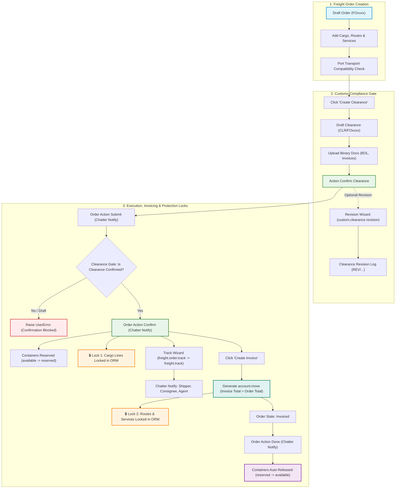

# 🚢 Freight Management System (FMS)

[-714B67?style=flat&logo=odoo)](https://www.odoo.com)
[](https://www.gnu.org/licenses/lgpl-3.0.html)
[](https://www.python.org/)
[-success?style=flat&logo=checkmarx)](file:///home/nasim/programming/odoo19/env/freight_management_system/addons/Freight/trn_freight/tests/)
[]()

A comprehensive, enterprise-ready **Logistics, Shipping & Freight Operations Management** module built natively for **Odoo 19.0**. Designed to streamline global supply chains, multi-modal transport (Air, Sea, Land), container state lifecycles, customs clearances, document revisions, and multi-tenant isolation.

---

## 📌 Table of Contents
- [Architecture & Workflow](#-architecture--workflow)
- [Key Features](#-key-features)
- [Customs Clearance & Revisions (Task 6)](#-customs-clearance--revisions)
- [Tracking, Invoicing & Protection Locks (Task 7)](#-tracking-invoicing--protection-locks)
- [Role-Based Access Control (RBAC)](#-role-based-access-control-rbac)
- [Multi-Company Isolation Architecture](#-multi-company-isolation-architecture)
- [Automated Test Suite & Quality Assurance](#-automated-test-suite--quality-assurance)
- [Module Structure](#-module-structure)
- [Setup & Installation](#-setup--installation)

---

## 🏗️ Architecture & Workflow

The module connects freight shipping transactions with master data, container availability, customs compliance, and billing pipelines.



---

## ✨ Key Features

### 1. Freight Shipping Orders (`freight.shipping`)
- **Automated Sequencing:** Generates unique sequential codes (e.g., `FO00035`) via `ir.sequence`.
- **Multi-Modal Logistics:** Native support for:
  - **Land Transport:** Full Truckload (`FTL`) and Less Than Truckload (`FT`).
  - **Water / Ocean Transport:** Full Container Load (`FCL`) and Less than Container Load (`LCL`).
  - **Air Freight.**
- **Real-Time Financial & Volume Calculation:** High-performance stored compute fields calculating total cargo weight, total volume, route revenues, service costs, and grand totals.
- **Port Transport Consistency Constraints:** SQL/Python level validation (`_check_port_transport`) strictly preventing assignment of ports incompatible with the selected transport method (e.g., assigning a sea-only deep port to a land shipment).
- **Container State Machine:** Auto-transitions assigned containers from `available` $\rightarrow$ `reserved` upon order confirmation, and releases them back to `available` upon completion (`done`) or cancellation.
- **Audit-Safe Unlink Protection:** Orders in `confirmed` or `done` states cannot be deleted.

---

### 2. Multi-Modal Master Data
- **Ports & Terminals (`freight.port`):** Classifies ports with multi-modal capabilities (`is_land`, `is_air`, `is_water`), UN/LOCODE, and country references.
- **Containers (`freight.container`):** Standard 20ft, 40ft, High-Cube, Reefer containers with dimensional volume/weight limits and availability tracking (`available` / `reserved`).
- **Freight Routes (`freight.routes`):** Multi-leg route templates with source/destination ports and transport configurations.
- **Service & Vendor Catalog (`freight.service`):** Standard freight services (documentation, handling, customs inspection) with vendor price lists.

---

## 🛃 Customs Clearance & Revisions

Introduced to bridge operational freight orders with legal customs documentation and audit compliance:

| Component | Technical Model | Description |
| :--- | :--- | :--- |
| **Customs Clearance** | `custom.clearance` | Tracks customs declaration status (`draft`, `confirmed`, `done`), automatically inheriting ports, agent, and date from parent freight order. Name computed as `CLR/{order_name}`. |
| **Document Attachments** | `custom.clearance.line` | Stores regulatory files (`Binary`, `attachment=True`) such as Bills of Lading, Packing Lists, Certificates of Origin, and Commercial Invoices. |
| **Revision History** | `clearance.revision` | Immutable log of revisions tracking timestamp, author, mandatory reason, and notes (`REV/{clearance_name}/{seq}`). |
| **Revision Wizard** | `custom.clearance.revision` | Fast modal popup (`TransientModel`, `target='new'`) for drafting revisions with reason validation. |

### Business Rules Enforced:
1. **Confirmation Gate:** An order cannot transition to `confirmed` unless an attached customs clearance exists and is in `confirmed` or `done` state.
2. **Cascaded Draft Deletion:** Deleting a `draft` order automatically cleans up its associated `draft` clearance.
3. **Confirmed Clearance Lockdown:** An order with an active `confirmed` or `done` clearance cannot be deleted under any circumstances.
4. **Smart Navigation:** Dynamic stat buttons on Freight Orders show total clearances; stat buttons on Clearance forms show revision counters with instant one-click drill-down.

---

## 📍 Tracking, Invoicing & Protection Locks (Task 7)

Connects operational freight orders to financial accounting, logs real-time transit milestones, broadcasts stakeholder notifications, and enforces backend integrity locks:

| Component | Technical Model | Description |
| :--- | :--- | :--- |
| **Tracking Model** | `freight.track` | Tracks transit legs on the order: `date`, `source_port_id`, `destination_port_id`, `transport`, and status (`Received` / `Delivered`). |
| **Tracking Wizard** | `freight.order.track` | Instant modal popup launched via the "Track" button on confirmed/invoiced orders; creates tracking records and posts chatter messages. |
| **Accounting Invoicing** | `account.move` (`out_invoice`) | Generates customer invoices for the shipper using `Command.create` with exactly 1 line per cargo line, route line, and service line. |
| **Integrity Locks** | Python ORM (`create`, `write`, `unlink`) | Strict ORM-level constraints blocking modification or removal of operational lines once orders advance. |

### Business Rules Enforced:
1. **Financial Exactness:** Customer Invoice Total **must exactly equal** Freight Order Total (`invoice.amount_total == order.total`) across weight-billed and volume-billed cargo, route pricing, and service fees.
2. **Cargo Line Lockdown:** Once an order reaches `confirmed` (or `invoiced`, `done`), cargo lines cannot be created, modified, or deleted (`UserError` raised on ORM level).
3. **Route & Service Line Lockdown:** Once an order reaches `invoiced` (or `done`), route stops and value-added service lines cannot be modified, added, or unlinked.
4. **Partner Notifications:** Dynamic notifications are broadcast to Shipper, Consignee, and Customs Agent upon `Submit`, `Confirm`, `Track`, and `Done` transitions.
5. **Smart Navigation:** A dedicated `Invoices` stat button on the Freight Order displays the invoice count and provides direct one-click navigation to the generated invoice.

---

## 🛡️ Role-Based Access Control (RBAC)

Structured access matrix defined in `trn_freight/security/ir.model.access.csv`:

| Model | Model Name | Freight User (`group_freight_user`) | Freight Manager (`group_freight_manager`) |
| :--- | :--- | :---: | :---: |
| `freight.shipping` | Freight Order | **Read, Write, Create** *(Delete Blocked)* | **Full CRUD** (`1, 1, 1, 1`) |
| `freight.cargo.line` | Cargo Line Items | **Full CRUD** (`1, 1, 1, 1`) | **Full CRUD** (`1, 1, 1, 1`) |
| `freight.route.line` | Route Stop Lines | **Full CRUD** (`1, 1, 1, 1`) | **Full CRUD** (`1, 1, 1, 1`) |
| `freight.order.service`| Service Lines | **Full CRUD** (`1, 1, 1, 1`) | **Full CRUD** (`1, 1, 1, 1`) |
| `freight.track` | Tracking Lines | **Full CRUD** (`1, 1, 1, 1`) | **Full CRUD** (`1, 1, 1, 1`) |
| `custom.clearance` | Customs Clearance | **Read, Write, Create** *(Delete Blocked)* | **Full CRUD** (`1, 1, 1, 1`) |
| `custom.clearance.line`| Clearance Documents | **Full CRUD** (`1, 1, 1, 1`) | **Full CRUD** (`1, 1, 1, 1`) |
| `clearance.revision` | Revision History | **Full CRUD** (`1, 1, 1, 1`) | **Full CRUD** (`1, 1, 1, 1`) |
| `custom.clearance.revision`| Revision Wizard | **Transient Execution** (`1, 1, 1, 1`) | **Transient Execution** (`1, 1, 1, 1`) |
| `freight.port` | Ports (Master Data) | **Read-Only** (`1, 0, 0, 0`) | **Full CRUD** (`1, 1, 1, 1`) |
| `freight.container` | Containers (Master Data) | **Read-Only** (`1, 0, 0, 0`) | **Full CRUD** (`1, 1, 1, 1`) |
| `freight.price` | Price Lists (Master Data) | **Read-Only** (`1, 0, 0, 0`) | **Full CRUD** (`1, 1, 1, 1`) |
| `freight.routes` | Routes (Master Data) | **Read-Only** (`1, 0, 0, 0`) | **Full CRUD** (`1, 1, 1, 1`) |
| `freight.service` | Services (Master Data) | **Read-Only** (`1, 0, 0, 0`) | **Full CRUD** (`1, 1, 1, 1`) |

> **Audit Security Principle:** Internal operational users can create, update, and progress freight transactions and customs documents, but are strictly prohibited from deleting orders and clearances or altering core pricing and port master data.

---

## 🏢 Multi-Company Isolation Architecture

Configured in `trn_freight/security/freight_security.xml`:
- **Record Rule Domain:**
  ```python
  ['|', ('company_id', '=', False), ('company_id', 'in', company_ids)]
  ```
- **Stored Related Segregation:** Every child model (`cargo.line`, `route.line`, `order.service`, `track`, `custom.clearance.line`, `clearance.revision`) inherits `company_id` directly from its parent document with `store=True, index=True`.
- **Zero Leakage:** Users belonging exclusively to Company B cannot read, search, or access records belonging to Company A through ORM queries, direct IDs, or child line joins.

---

## 🧪 Automated Test Suite & Quality Assurance

The codebase contains an enterprise-grade automated test suite executed via Odoo's test runner across clean throwaway databases:

```bash
python3 odoo-bin -c config.conf -d freight_test -i trn_freight --test-tags=/trn_freight --stop-after-init
```

### Verified Test Matrix (16 / 16 Passed - 100% Green):

| Test Suite | Test Case | Target Verification | Result |
| :--- | :--- | :--- | :---: |
| **`TestFreightOrder`** | `test_totals_calculated_correctly` | Verified weight, volume, and pricing totals computation. | ✅ **PASS** |
| | `test_order_workflow_and_container_state` | Verified submit $\rightarrow$ confirm $\rightarrow$ done transitions & container reservation. | ✅ **PASS** |
| | `test_wrong_port_refused` | Verified `ValidationError` on mismatched port transport flags. | ✅ **PASS** |
| | `test_deleting_confirmed_order_refused` | Verified `UserError` blocking deletion of confirmed shipments. | ✅ **PASS** |
| **`TestCustomClearance`** | `test_full_clearance_and_order_flow` | Verified Order $\rightarrow$ Clearance $\rightarrow$ Upload docs $\rightarrow$ Confirm clearance $\rightarrow$ Confirm order. | ✅ **PASS** |
| | `test_order_confirm_refused_without_clearance`| Verified order confirmation rejection when clearance is missing. | ✅ **PASS** |
| | `test_draft_order_deletion_deletes_draft_clearance` | Verified cascading deletion of draft clearances with draft orders. | ✅ **PASS** |
| | `test_order_with_confirmed_clearance_cannot_be_deleted` | Verified `UserError` blocking deletion of orders with confirmed clearance. | ✅ **PASS** |
| | `test_revision_wizard_creates_revision` | Verified `TransientModel` wizard creating revisions with audit reasons. | ✅ **PASS** |
| **`TestFreightSecurity`** | `test_multi_company_isolation` | Verified multi-company data segregation between Company A and Company B. | ✅ **PASS** |
| | `test_normal_user_delete_blocked_manager_allowed` | Verified ACL enforcement: user delete blocked (`AccessError`), manager allowed. | ✅ **PASS** |
| **`TestTrackingInvoicingLocks`** | `test_invoice_creation_and_matching_totals_weight_and_volume` | Verified `account.move` creation, one line per cargo/route/service, Invoice Total == Order Total. | ✅ **PASS** |
| | `test_cargo_line_locks` | Verified Python ORM locks on cargo lines (`create`, `write`, `unlink`) once Confirmed or later. | ✅ **PASS** |
| | `test_route_and_service_line_locks` | Verified Python ORM locks on route & service lines (`create`, `write`, `unlink`) once Invoiced or later. | ✅ **PASS** |
| | `test_tracking_wizard_and_partner_notifications` | Verified `freight.order.track` popup, tracking line creation & chatter message to partners. | ✅ **PASS** |
| | `test_notifications_on_submit_confirm_done` | Verified automatic chatter notifications to shipper, consignee and agent on order lifecycle. | ✅ **PASS** |

---

## 📁 Module Structure

```text
trn_freight/
├── __init__.py
├── __manifest__.py                 # Module metadata, dependencies (base, mail, uom, product, account)
├── data/
├── docs/                           # Detailed technical milestone reports & specifications
│   ├── 2026-11-02-freight-automated-test-suite.md
│   └── 2026-11-02-freight-multi-company-record-rules.md
├── models/
│   ├── __init__.py
│   ├── custom_clearance.py         # Customs Clearance, Document Lines & Revision models
│   ├── freight_container.py        # Container master data & capacity
│   ├── freight_port.py             # Ports & multi-modal transport capabilities
│   ├── freight_price.py            # Pricing templates & rate cards
│   ├── freight_routes.py           # Multi-leg route templates
│   ├── freight_service.py          # Value-added freight services
│   └── freight_shipping.py         # Main Freight Order model, Locks & Accounting integration
├── security/
│   ├── freight_security.xml        # User groups (User/Manager) & 14 Multi-Company Record Rules
│   └── ir.model.access.csv         # Role-based access control (RBAC) matrix
├── tests/
│   ├── __init__.py
│   ├── test_custom_clearance.py    # Automated test suite for Task 6
│   ├── test_freight_order.py       # Functional unit tests for shipping operations
│   ├── test_security.py            # Security & isolation unit tests
│   └── test_tracking_invoicing_locks.py # Unit tests for Task 7 (Invoicing, Locks, Tracking)
├── views/
│   ├── custom_clearance.xml        # Clearance form, list, statusbar & smart buttons
│   ├── custom_clearance_revision_wizard.xml  # Modal wizard popup view (target="new")
│   ├── freight_container.xml       # Container views
│   ├── freight_order_track_wizard.xml # Tracking popup wizard view
│   ├── freight_port.xml            # Port views
│   ├── freight_price.xml           # Price views
│   ├── freight_routes.xml          # Route views
│   ├── freight_sequence.xml        # ir.sequence definitions
│   ├── freight_service.xml         # Service catalog views
│   └── freight_shipping.xml        # Shipping order form, list, search, statinfo buttons
└── wizard/
    ├── __init__.py
    ├── custom_clearance_revision.py# TransientModel for revision wizard
    └── freight_order_track.py      # TransientModel for tracking popup wizard
```

---

## 🚀 Setup & Installation

### 1. Prerequisites
- **Odoo:** 19.0 Community or Enterprise Edition.
- **Python:** 3.10+ (Recommended Python 3.12).
- **PostgreSQL:** 14+.

### 2. Add to Addons Path
Add the addons directory to your Odoo configuration file (`odoo.conf`):
```ini
addons_path = /path/to/odoo/addons,/home/nasim/programming/odoo19/env/freight_management_system/addons/Freight
```

### 3. Install Module
Run module installation via terminal or Odoo Apps UI:
```bash
python3 odoo-bin -c config.conf -d freight -i trn_freight
```

### 4. Run Automated Test Suite
```bash
python3 odoo-bin -c config.conf -d freight --test-tags=/trn_freight --stop-after-init
```

---

## 👨‍💻 Author & Maintainer
- **Author:** Nasim Ullah
- **Technology Partner:** Aetos Technology
- **Version:** `19.0.1.0.5`
- **License:** LGPL-3
