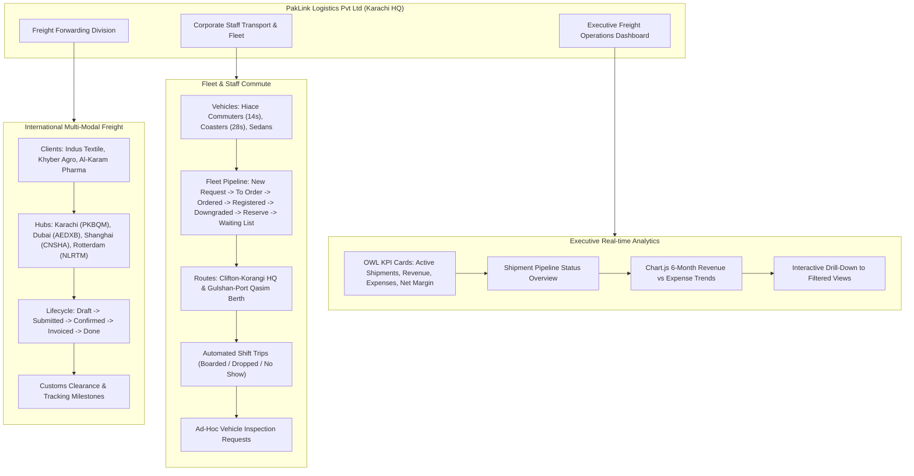

# Task 12: Demo Data, Final Verification & Final Demo Blueprint

## 1. Executive Business Scenario: "PakLink Logistics Pvt Ltd"

PakLink Logistics Pvt Ltd is a premier multi-modal 3PL logistics and transport operations provider based in Karachi, Pakistan. The enterprise operates two core synchronized operational divisions alongside executive intelligence:

---

## 2. Technical Concepts & Review Questions

### Q1: What does `noupdate="1"` change when a module is upgraded with `-u`?
- **`noupdate="0"` (Default):** Every time the module is upgraded via `-u module_name`, Odoo re-reads the XML data file and overwrites database records with XML values, erasing any modifications made via the UI.
- **`noupdate="1"`:** Instructs Odoo to create the records during initial installation (`-i`), but **never overwrite or alter them** during subsequent upgrades (`-u`).
- **Use Case:** Essential for demo data, production default masters, and sequences so that live operational changes or user customizations are preserved.

### Q2: Why should demo data trigger workflow methods (e.g. `action_submit`, `action_confirm`) instead of directly writing `state="confirmed"`?
- State fields in Odoo models have cascading business logic, checks, and side effects attached to their transition methods:
  1. **Validation Checks:** Missing ports, empty cargo lines, or zero quantities are blocked.
  2. **Sequence Assignment:** Reference numbers (e.g., `SO-0001`, `CLR-0001`, `TRIP-0001`) are automatically drawn.
  3. **Associated Records:** Linked tracking events, customs clearance folders, and journal items are initialized.
  4. **Chatter & Audit Trail:** Activity tracking, notifications, and logging are published to the chatter.
- Writing `state="confirmed"` directly via XML or SQL bypasses all validation and triggers, leaving orphaned records and corrupt relational data.

### Q3: Why is `post_init_hook` necessary alongside XML data?
- XML is purely declarative; it cannot execute state transition methods, simulate interactive user actions (like approving vehicle requests or boarding passengers), or trigger wizard workflows cleanly.
- `post_init_hook` runs Python code immediately after all XML records are loaded during initial installation, enabling programmatic execution of workflow methods across the entire data lifecycle.

---

## 3. Step-by-Step Implementation Roadmap

| Step | Scope | Key Deliverables |
| :--- | :--- | :--- |
| **Step 1** | **Module Scaffolding** | Create `trn_logistics_demo_data` directory, `__manifest__.py` (depending on `trn_freight`, `trn_staff_transport`, `trn_freight_dashboard`), `__init__.py`, and `hooks.py` with `post_init_hook`. |
| **Step 2** | **Master & Foundation Data** | XML data for `PakLink Logistics` company profile, 6+ Partners (Shippers, Consignees, Vendors), Ports & Airports (PKBQM, AEDXB, CNSHA, NLRTM, OPKC, FRA), Container Types, Service Catalog, 7 Fleet Vehicle States, Transport Routes & Stops. |
| **Step 3** | **Operational Freight Data** | 6 realistic Freight Orders executed via workflow methods across Draft, Submitted, Confirmed, Invoiced, Done, Cancelled stages; linked Customs Clearance records and Milestones. |
| **Step 4** | **Staff Transport Data** | Fleet vehicles, assigned drivers, HR employees mapped to stops, recurring weekday schedules, daily trips with passenger attendance (`boarded`, `dropped`, `no_show`), and sample vehicle requests. |
| **Step 5** | **Fresh DB Verification & Tests** | Single-command installation (`-i trn_freight,trn_staff_transport,trn_freight_dashboard,trn_logistics_demo_data`) on a clean database; automated tests across all 4 modules; verification of OWL dashboard live KPIs. |
| **Step 6** | **Final Demo Preparation** | Update `LEARNING_LOG.md` with Task 11 & Task 12; construct a structured 30-minute supervisor walkthrough demonstration script. |
